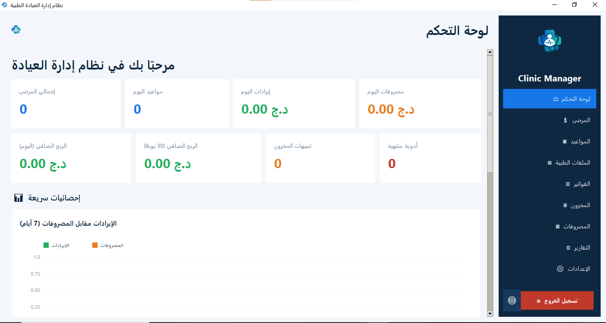
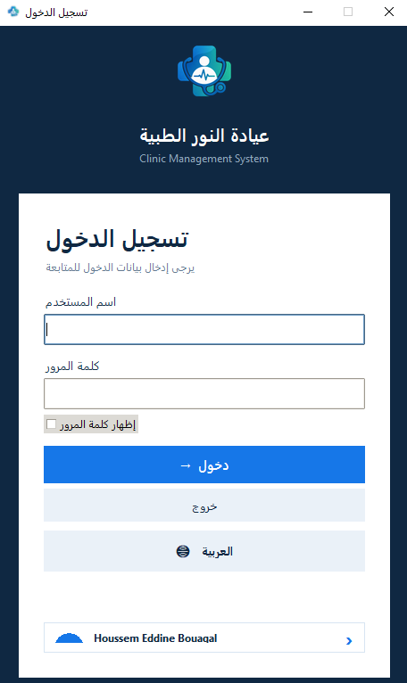
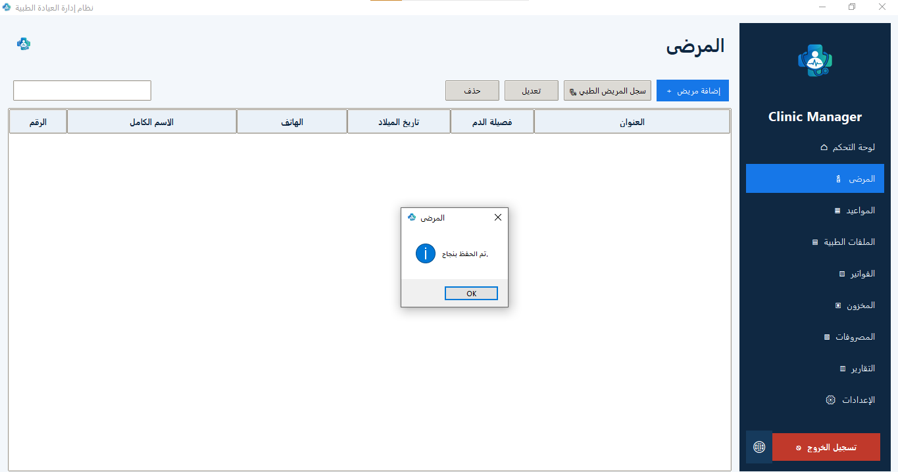
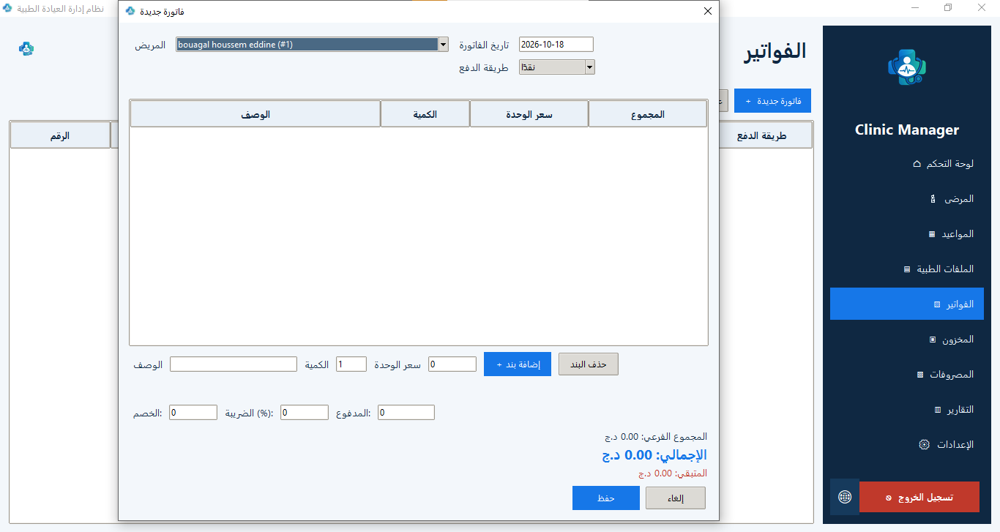
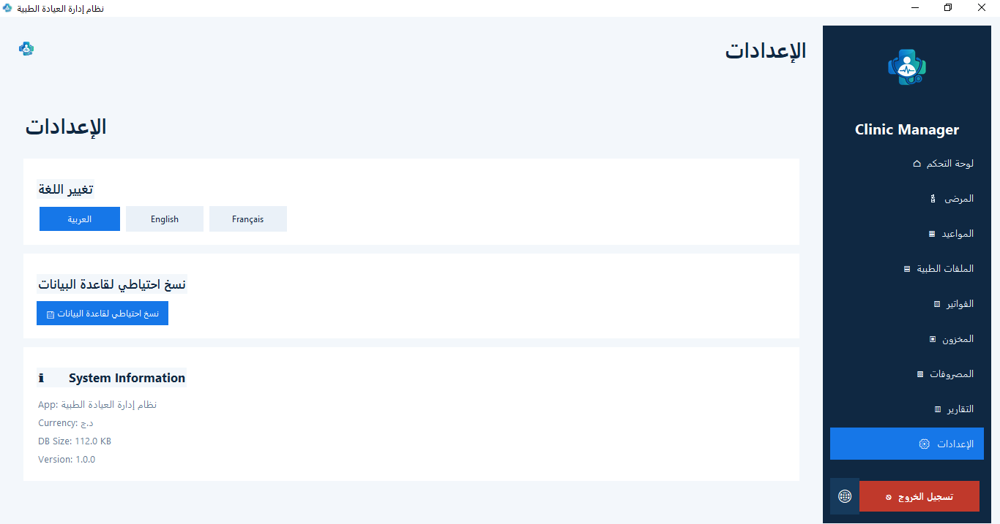

# Medical Clinic Management System

A desktop application designed to manage the daily operations of a single-doctor medical clinic. Built with **Python**, **Tkinter**, and **SQLite**, it provides a multilingual interface in Arabic, English, and French.

## 📸 Screenshots

### Application Interface


### Login Screen


### Patient Management


### Invoice Management


### Settings


## ✨ Features

- 🔐 Login screen before accessing the main application.
- 👤 Patient management and contact information.
- 📅 Appointment scheduling and status tracking.
- 🩺 Medical records and visit information.
- 📦 Inventory management, quantities, and expiration dates.
- 🧾 Invoice creation, invoice items, and payment tracking.
- 💰 Expense tracking.
- 📊 Reports and charts.
- 📝 Activity logging.
- 💾 Database backup support.
- 🌍 Multilingual interface: Arabic, English, and French.

## 🛠️ Technology Stack

- **Python** — application logic.
- **Tkinter** — desktop graphical user interface.
- **SQLite** — local database.
- **SQLite WAL mode** — database concurrency and performance.
- **Tkinter Canvas** — custom charts implemented in `charts.py`.

## 📂 Project Structure

```text
Clinic-Management-System/
├── assets/
│   ├── Login.png
│   ├── Facture.png
│   ├── patients.png
│   ├── settings.png
│   └── UI.png
├── data/
│   └── clinic_manager/
├── charts.py
├── db.py
├── i18n.py
├── main.py
├── Logo.png
├── requirements.txt
├── LICENSE
└── README.md
```

## ⚙️ Requirements

- Python 3.10 or newer is recommended.
- Tkinter, usually included with Python on Windows.
- SQLite, included with Python's standard library.
- Any additional third-party packages imported by `main.py`.

## 🚀 Getting Started

### 1. Clone the Repository

```bash
git clone https://github.com/HoussemBouagal/Clinic-Management-System.git
cd Clinic-Management-System
```

### 2. Verify Python

```bash
python --version
```

### 3. Install Dependencies

If `requirements.txt` contains the project's dependencies, run:

```bash
python -m pip install -r requirements.txt
```

### 4. Initialize the Database

```bash
python db.py
```

This step assumes that `db.py` supports standalone initialization. If database initialization happens automatically when the application starts, run the application directly instead.

### 5. Run the Application

```bash
python main.py
```

## 🗄️ Database

The application database includes the following tables:

| Table | Description |
|---|---|
| `patients` | Patient information |
| `appointments` | Appointment details and status |
| `medical_records` | Medical visits and records |
| `inventory` | Medical supplies and stock |
| `invoices` | Patient invoices |
| `invoice_items` | Invoice line items |
| `expenses` | Clinic expenses |
| `activity_log` | Recorded application activities |

The database filename is configured by `DB_FILE` in `db.py` and defaults to `clinic.db`.

## 💾 Backup and Recovery

The application includes a database backup helper based on SQLite's online backup API.

- Create backups regularly.
- Store backups in a secure location separate from the application.
- Verify that backups can be restored.
- Never publish real patient data or database backups in a public repository.

## 🔒 Security and Privacy

- Use strong, unique login credentials.
- Do not use default credentials in a production environment.
- Restrict access to the clinic computer and application files.
- Protect database files and backups because they may contain sensitive medical and financial information.
- SQLite databases are not encrypted automatically.
- Review the consequences of deleting patient records: some foreign-key relationships may use `ON DELETE CASCADE`, which can delete related records.
- Test the application with sample data before using it with real patients.

## 🌐 Supported Languages

The translation module `i18n.py` provides translations for:

- Arabic
- English
- French

## 📌 Project Status

This README describes the features and structure identified in the project files. Verify all workflows, login behavior, dependencies, and backup procedures before deploying the application in a real clinical environment.

## 📄 License

This project is licensed under the **MIT License**, provided that the repository's `LICENSE` file contains the applicable MIT License text.

## 👨‍💻 Author

**Houssem Bouagal**

- **Email:** [mouhamedhoussem813@gmail.com](mailto:mouhamedhoussem813@gmail.com)
- **LinkedIn:** [Houssem Eddine Bouagal](https://www.linkedin.com/in/houssem-eddine-bouagal-98025a297)
- **Portfolio:** [houssembouagal.github.io/Portfolio](https://houssembouagal.github.io/Portfolio/)

---

⭐ If you find this project useful, consider giving the repository a star.
